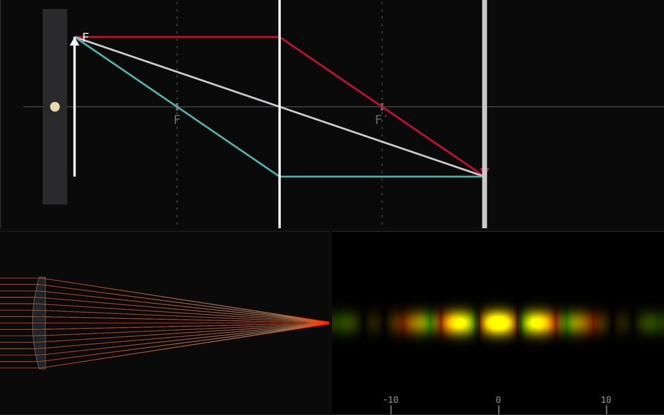

# Banc d'optique : lentilles, conditions de Gauss et diffraction d'un laser

🇫🇷 [Français](#français) · 🇬🇧 [English](#english)

**Essayer la démo :** https://valentin-auger-laboratoire.github.io/portfolio/demos/banc-optique/

---

## Français

### D'où vient le projet
En TP d'optique de **CPGE TSI**, on travaillait sur un banc : une lampe et un objet, des lentilles convergentes et divergentes qu'on déplace, un écran, puis un laser et des fentes pour la diffraction, toujours « dans l'approximation des petits angles ». Je n'ai plus les photos ni les mesures de ce TP. J'ai donc **refait le banc de zéro en 2026** et je suis allé plus loin que le TP. Ce dépôt ne contient ni le sujet, ni le cours, ni le compte rendu.

### Ce que fait la démo (6 onglets)
1. **Banc d'optique**
   - On déplace à la souris la source, jusqu'à 3 lentilles et l'écran.
   - Construction avec les 3 rayons particuliers et les plans focaux, ou faisceau réel limité par les montures.
   - Calculs par les matrices de transfert et la relation de Descartes.
   - Sur l'écran, flou et éclairement réels : l'éclairement varie en 1/γ².
   - Mode œil (œil réduit qui accommode de 25 cm à l'infini) : loupe, lunette de Kepler, et l'exemple de Mars observée avec une lunette de 100 et 25 mm, puis tenue à l'envers.
   - Laser gaussien : focalisation et élargisseur de faisceau.
   - Mesure de focale par Descartes (régression) et par Bessel (simulation de Monte-Carlo de la latitude de mise au point et de la lecture au mm).
2. **Schémas à connaître** : les 26 constructions du programme.
   - Lentille convergente et divergente dans tous les cas d'objet.
   - Rayons incidents et émergents quelconques.
   - Miroir plan, Snell-Descartes et réflexion totale.
   - Prisme, fibre, loupe, lunette, œil normal, myope et hypermétrope, appareil photo.
   - Chaque schéma est calculé, puis se construit étape par étape. Il y a un mode révision, un quiz sur la nature de l'image et une planche imprimable.
3. **Conditions de Gauss** : tracé de rayons exact (loi de Snell-Descartes vectorielle) dans des lentilles épaisses.
   - Verres N-BK7, F2, N-SF11 et silice, indices calculés par la formule de Sellmeier.
   - Aberration sphérique en h² : une lentille plan-convexe en a environ 4 fois plus dans le mauvais sens.
   - Meilleur plan de mise au point, comparé à la tache d'Airy.
   - Chromatisme, et doublet achromatique corrigé par un tracé épais.
   - Tableau sin θ ≈ θ.
4. **Réfraction, prisme, fibre**
   - Dioptre plan : coefficients de Fresnel Rs et Rp, angle limite, incidence de Brewster.
   - Prisme : courbe D(i), minimum de déviation, mesure de l'indice, lumière blanche.
   - Fibre à saut d'indice : ouverture numérique, cône d'acceptance, pertes hors du cône. La dispersion modale limite le débit, comparé à une fibre à gradient d'indice.
5. **Laser, interférences, diffraction**
   - Sources : 6 lasers (405 à 650 nm), une longueur d'onde libre, deux lasers superposés ou une lampe blanche.
   - Fente, cheveu (principe de Babinet), trou (fonction de Bessel J1), fentes et trous d'Young avec I₂/I₁ et contraste Γ, réseau.
   - Angles exacts comparés aux petits angles. Fresnel (intégrales de Fresnel) quand l'écran est proche.
   - Mesure du diamètre d'un cheveu, avec son incertitude.
6. **Vérifications** : environ vingt contrôles recalculés en direct dans le navigateur.

### Fichiers
| Fichier | Contenu |
|---|---|
| `demo/optique.js` | moteur de calcul : verres, matrices, tracé exact, réfraction, diffraction |
| `demo/schemas.js` | les 26 schémas, calculés puis découpés en étapes (SVG) |
| `demo/index.html` | interface de la démo |
| `demo/tests/test.js` | 2 602 vérifications : `node demo/tests/test.js` |

Exemples de vérifications :
- relation de Descartes contre matrices de transfert, sur 400 systèmes tirés au hasard ;
- formule de la lentille épaisse ;
- loi de Snell, lame à faces parallèles ;
- aberration en h², doublet dont les foyers F et C coïncident ;
- valeurs tabulées des intégrales de Fresnel et zéros de J1 ;
- passage de Fresnel à Fraunhofer, bord d'ombre à 1/4 ;
- contraste mesuré égal à 2√r/(1 + r) ;
- minimum de déviation du prisme, ouverture numérique de la fibre ;
- dans chaque schéma, les 3 rayons passent par B′.

### Limites
- Banc : lentilles minces en optique paraxiale.
- Tracé exact : dans le plan méridien seulement, pour des faces sphériques.
- Laser gaussien idéal (M² = 1).
- Diffraction de Fraunhofer en éclairage cohérent, et Fresnel seulement pour la fente.
- Fibre : modèle des rayons, sans dispersion chromatique (ordres de grandeur).
- Œil : modèle de l'œil réduit.

Ce n'est pas un logiciel de conception optique.

Sources des données : coefficients de Sellmeier du catalogue Schott (N-BK7, F2, N-SF11) et de Malitson (1965) pour la silice.

---

## English

### Background
In a **CPGE TSI** optics lab we worked on an optical bench: a lamp and an object, converging and diverging lenses we moved around, a screen, then a laser and slits for diffraction, always "in the small-angle approximation". I no longer have the photos or the measurements, so I **rebuilt the bench from scratch in 2026** and went further than the lab. This repository contains neither the lab handout, nor the course, nor the report.

### What the demo does (6 tabs)
1. **Optical bench**
   - Drag the source, up to 3 lenses and the screen with the mouse.
   - Construction with the 3 principal rays and the focal planes, or the real beam limited by the mounts.
   - Computed with transfer matrices and the Descartes relation.
   - Real blur and illuminance on the screen: illuminance varies as 1/m².
   - Eye mode (reduced eye accommodating from 25 cm to infinity): magnifier, Keplerian telescope, and the example of Mars seen through a 100 / 25 mm telescope, then held the wrong way round.
   - Gaussian laser: focusing and beam expander.
   - Focal-length measurement by Descartes (regression) and Bessel (Monte Carlo simulation of the depth of focus and of the mm reading).
2. **Diagrams to know**: the 26 constructions of the syllabus.
   - Converging and diverging lens for every object position.
   - Arbitrary incident and emerging rays.
   - Plane mirror, Snell's law and total internal reflection.
   - Prism, fibre, magnifier, telescope, normal, short-sighted and long-sighted eye, camera.
   - Each diagram is computed, then built step by step. There is a revision mode, a quiz on the nature of the image and a printable sheet.
3. **Paraxial conditions**: exact ray tracing (vector Snell law) through thick lenses.
   - N-BK7, F2, N-SF11 and silica glasses, indices from the Sellmeier formula.
   - Spherical aberration in h²: a plano-convex lens turned the wrong way has about 4 times more.
   - Best focus plane, compared with the Airy disc.
   - Chromatic aberration, and an achromatic doublet corrected with a thick trace.
   - sin θ ≈ θ table.
4. **Refraction, prism, fibre**
   - Plane interface: Fresnel coefficients Rs and Rp, critical angle, Brewster's angle.
   - Prism: D(i) curve, minimum deviation, index measurement, white light.
   - Step-index fibre: numerical aperture, acceptance cone, losses outside the cone. Modal dispersion limits the data rate, compared with a graded-index fibre.
5. **Laser, interference, diffraction**
   - Sources: 6 lasers (405 to 650 nm), a free wavelength, two superimposed lasers or a white lamp.
   - Slit, hair (Babinet's principle), hole (Bessel function J1), Young's slits and holes with I₂/I₁ and contrast Γ, grating.
   - Exact angles compared with small angles. Fresnel (Fresnel integrals) when the screen is close.
   - Measuring the diameter of a hair, with its uncertainty.
6. **Checks**: about twenty checks recomputed live in the browser.

### Files
| File | Contents |
|---|---|
| `demo/optique.js` | engine: glasses, matrices, exact tracing, refraction, diffraction |
| `demo/schemas.js` | the 26 diagrams, computed then split into steps (SVG) |
| `demo/index.html` | demo interface |
| `demo/tests/test.js` | 2,602 checks: `node demo/tests/test.js` |

### Limits
- Bench: paraxial thin lenses.
- Exact tracing: meridional plane only, spherical surfaces.
- Ideal Gaussian laser (M² = 1).
- Fraunhofer diffraction with coherent illumination, and Fresnel only for the slit.
- Fibre: ray model, no chromatic dispersion (orders of magnitude).
- Eye: reduced eye model.

Not optical design software.

Data sources: Sellmeier coefficients from the Schott catalogue (N-BK7, F2, N-SF11) and Malitson (1965) for fused silica.

---

[← Retour au portfolio / Back to the portfolio](https://valentin-auger-laboratoire.github.io/portfolio/)
